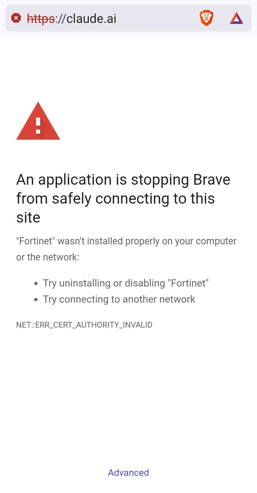
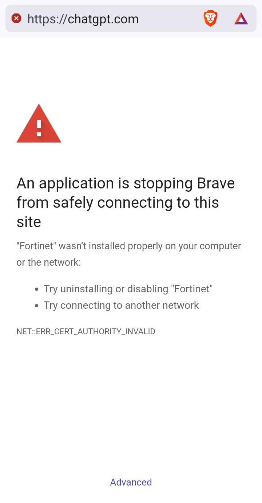
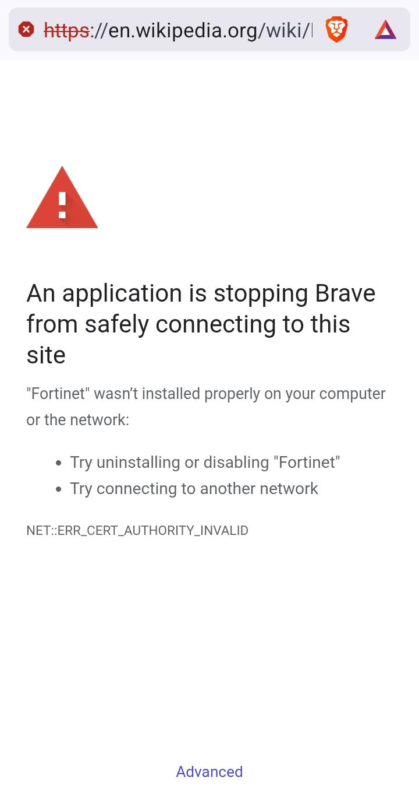

# Why sshuttle2 exists

*Or: how a hospital firewall made me write a VPN.*

Also on the web: [sshuttle2.openrepos.org](https://sshuttle2.openrepos.org/). Source: [github.com/allwinpower/sshuttle2](https://github.com/allwinpower/sshuttle2).

sshuttle2 is a full Rust implementation inspired by [sshuttle](https://github.com/sshuttle/sshuttle).

## Admitted

I ended up in a hospital. The staff were kind, the bed was fine, and I still had work to do. I had my Mac and my phone with me, and the hospital has patient Wi-Fi. Great, I thought, and opened the laptop.

## Symptoms

The patient Wi-Fi sits behind a Fortinet firewall, and that firewall has opinions. The Mac and the phone got the same treatment. The screenshots are from the phone (Brave on Android).

| claude.ai | chatgpt.com | en.wikipedia.org |
|---|---|---|
|  |  |  |

Three sites, three identical refusals.

What the firewall blocked, on both devices:

- **Claude**, **ChatGPT** and every other AI tool I tried.
- **Every VPN**: WireGuard, Shadowsocks, Mullvad, and the rest.
- **Wikipedia.** The free encyclopedia. In a building full of people who want to look up their own diagnosis.

The error is `NET::ERR_CERT_AUTHORITY_INVALID`. The firewall opens every HTTPS connection to look inside and signs the result with its own certificate. My devices have never met that certificate, so they refuse the page.

Brave offers two fixes:

1. *"Try uninstalling or disabling Fortinet."* Sure. I'll walk to the hospital's server room in my patient gown and ask nicely.
2. *"Try connecting to another network."* Patients don't get to pick the network.

## Examination

I tried everything. One thing got through: **SSH**. Maybe the IT team needs it, maybe nobody thought about it. Either way, I could log in to my own server from the Mac.

```
          Fortinet
             |
 [Mac]   ----X---> claude.ai, chatgpt.com
 [phone] ----X---> wikipedia.org
         ----X---> WireGuard, Shadowsocks,
                   Mullvad, ...

 [Mac] == ssh :22 ==> [my server] --> internet
```

If you can SSH, you can tunnel. That is the idea behind [sshuttle](https://github.com/sshuttle/sshuttle): a VPN over a plain SSH login, with nothing to install on the server.

## First treatment: sshuttle

sshuttle worked on the Mac. Everything got through. Slowly.

- Downloads ran at **12.8 Mbit/s**. The same Wi-Fi does 91.9 Mbit/s to sites it doesn't block.
- A tiny page request waited **1.8 seconds**. With a download running next to it: **2.3 seconds**.

Every click felt like waiting for the doctor's round.

The cause is not a bug. sshuttle sends every byte through one single-threaded Python process on the server. On small cloud servers that caps it at about 30–45 Mbit/s, and every packet waits its turn in the same queue. sshuttle is a great idea and has helped people for years. It just could not carry my workday.

## Surgery

So before I could do my actual work, I had to fix my internet.

I wrote sshuttle2, a full Rust implementation inspired by [sshuttle](https://github.com/sshuttle/sshuttle). Both ends are new code, and it keeps the good idea: you need nothing on the server except an SSH login. It runs on the Mac (and on Linux). On first run the client uploads a small server program (about 1.3 MB) through SSH and reuses it after that.

What changed:

- **No Python in the data path.** Both ends are compiled Rust.
- **Many connections, one SSH session, separate lanes.** Each connection has its own flow control, so one big download doesn't block everything else.
- **Windows that size themselves.** Each lane grows while it limits the speed and shrinks when it only builds a queue. One download can use the link, and a page doesn't wait behind it.
- **TCP, DNS, and all UDP.** In tun mode video calls, QUIC and games go through the tunnel too.
- **Clean exit.** Firewall rules and routes are removed when it stops, even after a crash.

## Vitals after surgery

Measured on the Mac. Same Wi-Fi, same server (2 vCPU, 4 GB), same day (23 October 2026). Single samples; a repeat with medians is on the [TODO](TODO.md) list.

| | Download | Page wait, idle | Page wait, during a download |
|---|---:|---:|---:|
| No tunnel (blocked sites stay blocked) | 91.9 Mbit/s | 128 ms | 65 ms |
| sshuttle | 12.8 Mbit/s | 1817 ms | 2281 ms |
| **sshuttle2**, pf mode (TCP + DNS) | **19.1 Mbit/s** | **131 ms** | 338 ms |
| **sshuttle2**, tun mode (TCP + UDP + DNS) | 17.4 Mbit/s | 211 ms | **223 ms** |

*Download: one 100 MB file. Page wait: time until `google.com/generate_204` sends its first byte.*

- Pages answer about **14 times faster** than with sshuttle (1817 ms → 131 ms), and about 10 times faster while a download runs.
- Downloads are about **1.5 times faster**.
- There is still a gap: the bare Wi-Fi does 91.9 Mbit/s. The patient is stable, not cured.

## Discharge notes

I wrote this for myself, to get back to work. If it helps one more person stuck behind a firewall that blocks Wikipedia, it was worth it.

Take it. Fork it. Bomb it with pull requests. Vibe-code it until the doctor comes. In a hospital, that happens every morning at rounds.

The open ticket is right there in the table: get from 19 Mbit/s to 92.

---

sshuttle2 is inspired by [sshuttle](https://github.com/sshuttle/sshuttle); its firewall logic is ported from there. LGPL-2.1-or-later, like sshuttle.
